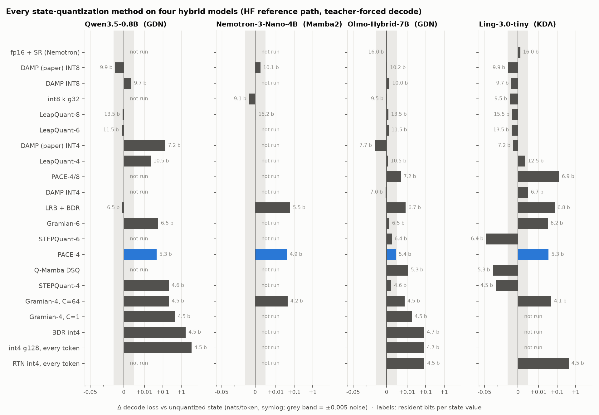
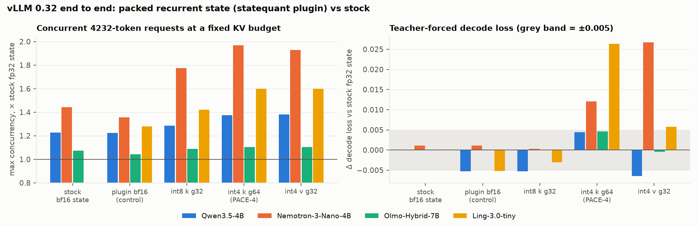
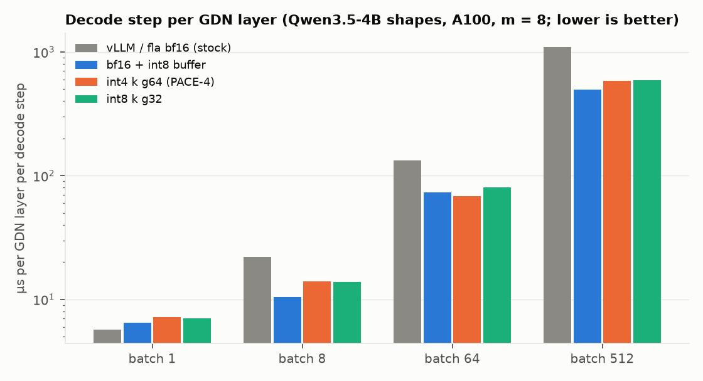

# Results

All numbers: `docs/figures/data/*.csv`; figures: `python docs/figures/make_figures.py`.

## Reference path, every preset

Loss deltas are against the unquantized model on the same windows (nats / token). Prompt: WikiText-103 test windows in one forward pass; decode: a prompt, then teacher-forced single-token steps through the cache. Bits per state value: payload; resident adds the decode buffer; peak adds transient records. With 1024 scored tokens, differences below about 0.005 are noise; rows below zero are not improvements.

### Qwen3.5-0.8B (GDN)

`examples/presets_loss.py --repo Qwen/Qwen3.5-0.8B --windows 4 --seq 2048 --decode-windows 2 --prompt 1024 --decode 512` (A100). Unquantized decode loss 2.8246.

| preset | Δ prompt | Δ decode | payload b/val | resident b/val | peak b/val |
|---|---:|---:|---:|---:|---:|
| `pace4` | -0.0015 | +0.0457 | 4.250 | 5.281 | 5.281 |
| `stepquant4` | +0.1953 | +0.2107 | 4.613 | 4.613 | 4.613 |
| `damp_int8` | +0.0003 | +0.0036 | 9.656 | 9.656 | 9.656 |
| `damp_paper_int8` | +0.0000 | -0.0042 | 9.875 | 9.875 | 9.875 |
| `damp_paper_int4` | +0.0000 | +0.1355 | 7.250 | 7.250 | 7.250 |
| `int4_g128` | +2.1353 | +3.5579 | 4.500 | 4.500 | 4.500 |
| `bdr_int4` | +1.5863 | +1.7228 | 4.500 | 4.500 | 4.500 |
| `lrb` | +0.0759 | +0.0592 | 6.502 | 6.502 | 8.502 |
| `lrb_bdr` | +0.0212 | -0.0007 | 6.502 | 6.502 | 8.502 |
| `lrb_bdr_fp32` | +0.0346 | +0.0303 | 6.502 | 6.502 | 8.502 |
| `leapquant8` | +0.0000 | -0.0006 | 9.500 | 13.516 | 13.516 |
| `leapquant8_fp32` | +0.0000 | -0.0009 | 9.500 | 13.516 | 13.516 |
| `leapquant6` | +0.0000 | -0.0011 | 7.500 | 11.516 | 11.516 |
| `leapquant4` | +0.0000 | +0.0217 | 6.500 | 10.516 | 10.516 |
| `gramian4` | +0.3757 | +0.4558 | 4.500 | 4.500 | 4.500 |
| `uniform4_blk32` | +1.7061 | +1.7205 | 4.500 | 4.500 | 4.500 |
| `gramian6` | +0.0458 | +0.0557 | 6.500 | 6.500 | 6.500 |
| `gramian4_c64` | +0.0202 | +0.2116 | 4.500 | 4.500 | 4.500 |
| `uniform4_blk32_c64` | -0.0062 | +0.0878 | 4.500 | 4.500 | 4.500 |

### Nemotron-3-Nano-4B (Mamba2)

2 windows of 1024 (prompt); decode 2 windows of 512 + 256; calibration 8 x 2048. Short run: decode deltas within about ±0.004 are noise. Unquantized decode loss 2.2738.

| preset | Δ prompt | Δ decode | payload b/val | resident b/val | peak b/val |
|---|---:|---:|---:|---:|---:|
| `pace4` | +0.0141 | +0.0401 | 4.250 | 4.867 | 4.867 |
| `int8k` | +0.0006 | -0.0030 | 8.500 | 9.117 | 9.117 |
| `leapquant8` | +0.0000 | +0.0002 | 9.950 | 15.175 | 15.175 |
| `damp_paper_int8` | +0.0000 | +0.0025 | 10.050 | 10.050 | 10.050 |
| `gramian4_c64` | +0.0116 | +0.0437 | 4.237 | 4.237 | 4.237 |
| `lrb_bdr` | +0.0839 | +0.0597 | 5.478 | 5.478 | 6.453 |

### Olmo-Hybrid-7B (GDN, d_k 96 / d_v 192)

**Every preset on the reference path** (transformers 5.20 + fla, bf16 weights, `examples/presets_loss.py --repo
allenai/Olmo-Hybrid-7B --windows 4 --seq 1024 --calib-seq 2048 --decode-windows 4 --prompt 512 --decode 256`, L40;
results in docs/figures/data/hf_presets.csv). Prompt loss: 4 WikiText-103 test windows of 1024 tokens in one forward pass; decode loss:
a 512-token prompt, then 256 teacher-forced single-token steps through the cache (4 windows). Bits per value as
`sq.report` gives them on d_k 96 / d_v 192 (payload; resident adds the decode buffer; peak adds LRB's transient
records). With 1024 scored tokens per column, differences below about 0.005 are within run-to-run noise of the
rounding (e.g. the negative decode deltas).

| preset | Δ prompt | Δ decode | payload b/val | resident b/val | peak b/val |
|---|---:|---:|---:|---:|---:|
| `pace4` | -0.0006 | +0.0045 | 4.333 | 5.361 | 5.361 |
| `int8k` | +0.0002 | -0.0002 | 8.500 | 9.528 | 9.528 |
| `pace48` | +0.0025 | +0.0069 | 5.725 | 7.246 | 7.246 |
| `damp_int8` | -0.0003 | +0.0014 | 9.958 | 9.958 | 9.958 |
| `damp_int4` | -0.0003 | -0.0005 | 6.000 | 7.028 | 7.028 |
| `qmamba_dsq` | +0.0006 | +0.0111 | 4.250 | 5.278 | 5.278 |
| `rtn` | +0.0607 | +0.0860 | 4.500 | 4.500 | 4.500 |
| `nemotron` | -0.0001 | -0.0000 | 16.000 | 16.000 | 16.000 |
| `stepquant4` | +0.0042 | +0.0023 | 4.578 | 4.578 | 4.578 |
| `stepquant6` | +0.0002 | +0.0025 | 6.358 | 6.358 | 6.358 |
| `lrb_bdr` | +0.0021 | +0.0092 | 6.668 | 6.668 | 8.668 |
| `leapquant8` | +0.0000 | +0.0008 | 9.500 | 13.514 | 13.514 |
| `leapquant6` | +0.0000 | +0.0010 | 7.500 | 11.514 | 11.514 |
| `leapquant4` | +0.0000 | +0.0006 | 6.500 | 10.514 | 10.514 |
| `gramian4_c64` | +0.0002 | +0.0088 | 4.500 | 4.500 | 4.500 |
| `gramian6` | +0.0006 | +0.0013 | 6.500 | 6.500 | 6.500 |
| `damp_paper_int8` | +0.0000 | +0.0003 | 10.167 | 10.167 | 10.167 |
| `damp_paper_int4` | +0.0000 | -0.0058 | 7.667 | 7.667 | 7.667 |
| `gramian4` | +0.0075 | +0.0178 | 4.500 | 4.500 | 4.500 |
| `int4_g128` | +0.0618 | +0.0815 | 4.667 | 4.667 | 4.667 |
| `bdr_int4` | +0.0419 | +0.0816 | 4.667 | 4.667 | 4.667 |

### Ling-3.0-tiny (KDA)

**Every preset on the reference path.** Ling-3.0-tiny (7.9B total / 1.3B active MoE; 18 KDA layers, 16 heads x 128 x
128; 6 MLA layers), bf16 weights, A100. Prompt: 4 WikiText-103 test windows of 1024 tokens. Decode: 4 windows, a
512-token prompt, then 256 tokens teacher-forced one at a time through the cache. Calibration: 8 x 1024 tokens.
Δ is against the unquantized model (prompt 2.2272, decode 1.7222). Bits per KDA state value: payload, resident (incl.
the decode buffer), peak. `examples/presets_loss.py --repo inclusionAI/Ling-3.0-tiny --windows 4 --seq 1024
--calib-seq 1024 --decode-windows 4 --prompt 512 --decode 256`; results in docs/figures/data/hf_presets.csv.

| preset | Δ prompt | Δ decode | payload b/val | resident b/val | peak b/val |
|---|---:|---:|---:|---:|---:|
| `rtn` | +0.2825 | +0.4245 | 4.500 | 4.500 | 4.500 |
| `nemotron` | +0.0107 | +0.0011 | 16.000 | 16.000 | 16.000 |
| `qmamba_dsq` | -0.0041 | -0.0178 | 4.250 | 5.281 | 5.281 |
| `damp_int8` | +0.0000 | -0.0032 | 9.656 | 9.656 | 9.656 |
| `damp_int4` | +0.0046 | +0.0049 | 5.656 | 6.688 | 6.688 |
| `pace4` | +0.0109 | +0.0349 | 4.250 | 5.281 | 5.281 |
| `pace48` | +0.0748 | +0.1274 | 5.656 | 6.930 | 6.930 |
| `int8k` | +0.0016 | -0.0040 | 8.500 | 9.531 | 9.531 |
| `stepquant4` | -0.0431 | -0.0124 | 4.533 | 4.533 | 4.533 |
| `stepquant6` | -0.0208 | -0.0412 | 6.358 | 6.358 | 6.358 |
| `lrb_bdr` | +0.0532 | +0.0740 | 6.750 | 6.750 | 8.750 |
| `leapquant8` | +0.0000 | -0.0028 | 9.500 | 15.500 | 15.500 |
| `leapquant6` | +0.0000 | -0.0031 | 7.500 | 13.500 | 13.500 |
| `leapquant4` | +0.0000 | +0.0035 | 6.500 | 12.500 | 12.500 |
| `gramian4_c64` | +0.0060 | +0.0481 | 4.148 | 4.148 | 4.148 |
| `gramian6` | +0.0285 | +0.0313 | 6.156 | 6.156 | 6.156 |
| `damp_paper_int8` * | +0.0000 | -0.0049 | 9.875 | 9.875 | 9.875 |
| `damp_paper_int4` * | +0.0000 | -0.0024 | 7.250 | 7.250 | 7.250 |

Notes on the table:
- `*` DampPaper needs calibration sequences of at least min(anchors) + H = 1536 tokens, so it ran with
  `--calib-seq 2048`. That run's eval windows start after the calibration tokens and are different windows: its
  unquantized reference is prompt 2.6710 / decode 2.3309.
- A Δ prompt of exactly 0 is by construction: LeapQuant rounds decode tokens and the prompt end only, and DampPaper
  keeps fp32 inside each prefill chunk (8192 tokens). DAMP INT8's +0.0000 is +2.4e-5.
- Several rows are below the unquantized model: `qmamba_dsq`, `int8k` decode, `stepquant4/6`, DampPaper decode.
  - That is a property of these windows (4 x 1024 prompt tokens, 4 x 256 decode tokens), not a measurement of
    improvement.
  - On one 64-token window `lrb_bdr` scored -0.197; on 4 x 256 it is +0.11. The decode path agrees with scoring the
    same tokens through the prompt path (checked for `none`, `int4_g128`, `lrb_bdr`, `pace4`, `int8k`).
- PACE-4/8 trails PACE-4 here. Its paper cell also rounds the prompt's keys to int4 (`buffer_in_prefill`).
